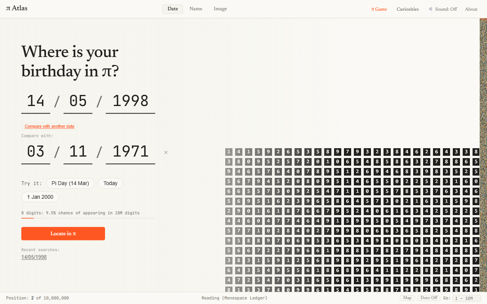
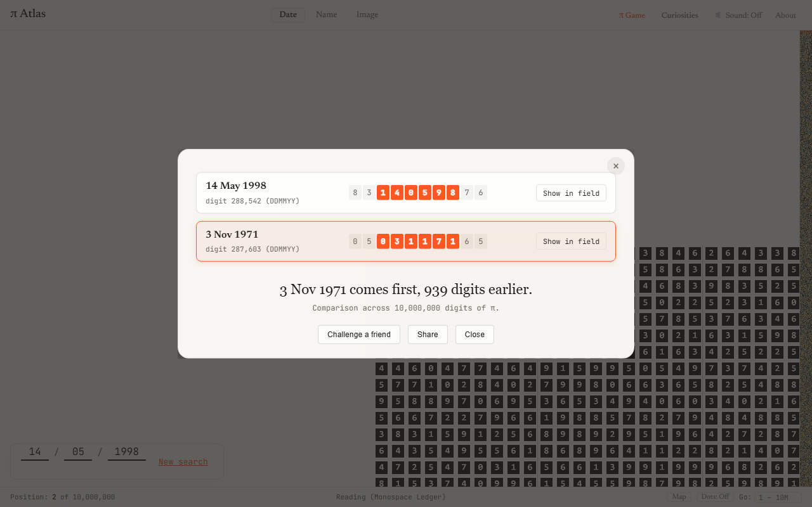
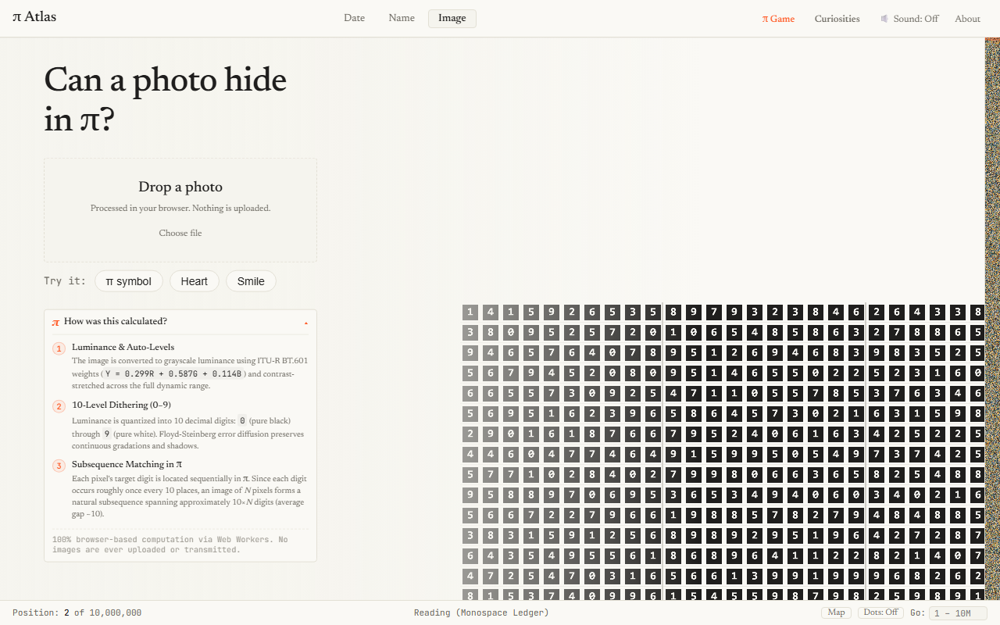

# π Atlas

An interactive cartographic explorer for the first 10,000,000 decimal digits of π.

Everything in π Atlas runs entirely inside your browser. No dates, names, images, or digit positions are ever transmitted to any server.

---

## Highlights

- **Birthday Finder & Duel**: Finds any calendar date across candidate formats (`DDMMYY`, `DMMYY`, `DDMMYYYY`, `YYYYMMDD`, `MMDDYY`). Compare two dates head-to-head with dual-ribbon inspection to see whose birthday appears earlier in π.
- **Telephone Cipher for Names**: Translates letters into numeric keypad digits ($A \to 2, B \to 2, \dots, Z \to 9$). Long names that do not appear contiguously are decomposed into the fewest greedy contiguous segments found in π.
- **Photos Encoded as Subsequences**: Converts any image into 10 decimal tones ($0 = \text{black}$ to $9 = \text{white}$) using Floyd-Steinberg error diffusion dithering. Each pixel maps to the next occurrence of that digit in π, creating a natural subsequence spanning approximately $10 \times \text{pixels}$ digits.
- **Mathematical Curiosities**: Navigate directly to famous landmarks, including the Feynman Point (`999999` at position 762), Euler’s number $e$, consecutive zeros, and ascending runs.
- **π Digit Challenge**: Test your memory depth in free-practice mode or race against a 30-second sprint timer with tactile keypad and keyboard controls.
- **Zero-Latency WebGL2 Rendering**: Multi-scale continuous zoom and pan powered by van Wijk interpolation, rendering millions of digits at 60 FPS without DOM thrashing.

---

## Visual Tour

### 1. The 10-Million Digit Canvas
*Multi-scale continuous camera zooming from full-atlas overview down to individual monospace ledger glyphs.*



---

### 2. Birthday Duel & Comparison
*Head-to-head comparison between two dates, revealing exact digit positions, synchronized ribbons, and honest distance calculations.*



---

### 3. Image Dithering & Subsequence Assembly
*Grayscale luminance quantization with Floyd-Steinberg error diffusion and client-side subsequence search.*



---

## Technical Architecture

### 1. WebGL2 Infinite Grid
The digit field is structured as a continuous 2D matrix of $10,000 \times 1,000$ digits. Rendering is handled via instanced quads reading from a compact 4-bit packed binary buffer (`pi_10m.bin`, 5 MB total).
- **Scale 1 (Overview)**: Grayscale density field reflecting digit distribution.
- **Scale 2 (Mid-range)**: Tonal tiles highlighting regional occurrences.
- **Scale 3 (Reading)**: Crisp monospace glyphs with active search highlights.

### 2. Fast Lookup & Multi-Threading
- **6-Digit $O(1)$ Table**: The first occurrence of all 1,000,000 six-digit sequences is indexed into a typed array upon load, allowing instant $O(1)$ resolution for dates and short names.
- **Dedicated Web Worker**: Subsequence searching, image dithering, and multi-format date scans run off the main thread in a dedicated Web Worker (`search.worker.ts`), keeping animations and camera navigation responsive.

### 3. Chunked Parallel Loading
`pi_10m.bin` is split into ten parallel 500 KB slices (`pi_00.bin` to `pi_09.bin`). On first visit, chunks are fetched in parallel and cached in IndexedDB. Subsequent visits load instantly from local storage with offline PWA readiness.

### 4. Privacy Guarantee
Every computation—image downsampling, phone keypad mapping, date candidate generation, and duel verdicts—is executed locally in client memory.

---

## Getting Started

### Prerequisites
- Node.js 18+
- Modern browser with WebGL2 support (Chrome, Firefox, Safari, Edge)

### Development
```bash
# Install dependencies
npm install

# Start local dev server
npm run dev
```

### Run Tests
```bash
npm test
```

### Production Build
```bash
npm run build
npm run preview
```

---

## Design System

π Atlas adheres to a restrained editorial aesthetic inspired by mathematical monographs and scientific instruments:

- **Typography**: Newsreader (editorial serif headings) and JetBrains Mono (tabular figures, coordinates, and digit readouts).
- **Palette**: Paper background (`#F5F4EE`), warm surface (`#FAF9F5`), carbon ink (`#1F1E1D`), and terracotta accent (`#FF5722`).
- **Restraint**: Zero emoji, zero confetti animations, zero artificial glow filters. All visual emphasis is derived from typography, glass-settle physics, and mathematical geometry.

---

## License

MIT License. Free for open mathematical exploration and educational use.
